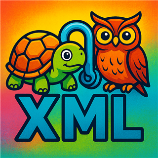

# The Bookshop Trail — an ontology course

*A Semantechs teaching resource.*

<br clear="left">

Seventy-six lessons that start with a word, a thing and the idea in between,
and end with an OWL 2 DL vocabulary a reasoner has agreed with. Half the course
is about meaning, systematics, naming, definitions and design principles,
because that is where ontologies go right or wrong. A quarter is RDFS, SKOS and
OWL 2, taught as one idea at rising degrees of commitment rather than as three
technologies. The rest is standing on an upper ontology, measuring what you
built, and living with change.

It is the third of three. The **[SPARQL course](https://www.semantechs.co.uk/SPARQL_Course/)**
asks the Bookshop Trail questions; the **[SHACL course](https://www.semantechs.co.uk/SHACL_Course/)**
checks its data; this one says what the terms mean. They share the data, the
editor and the house style, and lessons cite each other by number: a query
here is `q28`, a shape is `s51`, a lesson in this course is `o52`.

Everything here runs in one environment:

| Environment | What it is | Where it comes from |
|---|---|---|
| **Turtle Editor Viewer** | Browser editor with a graph view, a SPARQL panel, an OWL 2 RL reasoner behind **Show Facts**, and a SHACL panel with an Inference dropdown. Nothing you load leaves the page. | **[semantechs.co.uk/turtle-editor-viewer](https://semantechs.co.uk/turtle-editor-viewer/)**, used online; nothing to install |

Every lesson has been **put through the tools** as well: the OWL 2 profile
checker and HermiT (through ROBOT), an OWL 2 RL closure like the editor's,
pySHACL, the Ontology Quality Suite, the OQuaRE metrics, and the lesson's own
queries. What they found is written into each lesson's `MEASURED` line and laid
out in full in the [course document](https://www.semantechs.co.uk/Ontology_Course/).
Where a lesson seeds a fault, the measurement shows the tool finding it.

---

## Start here

Read [the brief](data/the-brief.md). It is a page from the Trail's committee,
written loosely on purpose; every ambiguity in it is a lesson.

Then open the editor:

**<https://semantechs.co.uk/turtle-editor-viewer/>**

and load the first lesson. This link does it for you:

<https://semantechs.co.uk/turtle-editor-viewer/?dot=https%3A%2F%2Fraw.githubusercontent.com%2Fpwin%2FOntology_Course%2Fmain%2Flessons%2F01-meaning%2Fo01-a-word-a-thing-and-the-idea-in-between.ttl>

The file arrives in the first tab; the graph view draws it; the header in the
file is the lesson. Read the header before you look at the graph. Then
[`lessons/00-the-lab/`](lessons/00-the-lab/) for twenty minutes on the editor
as a tool for looking at vocabularies, and on to
[`lessons/01-meaning/`](lessons/01-meaning/).

There is a single-page edition of the course too, [docs/index.html](docs/index.html),
hosted at **<https://www.semantechs.co.uk/Ontology_Course/>**: every lesson with
its model, its explanation, what the tools measured, and buttons that open it in
the editor or copy the model.

---

## One click into the editor

The Turtle Editor Viewer accepts `?dot=<url>` and loads that URL into the
editor, and `&shapes=<url>` opens a second file as a shapes tab already
selected for validation. Every lesson carries a **LOAD IT** line built that
way, and every lesson in the course document has an **Open in the editor**
button. Lessons with a companion shapes file, the label rules in o19, the SKOS
integrity conditions in o39, the style shapes in o67, the closure rule in o52,
open it in the second tab.

```
https://semantechs.co.uk/turtle-editor-viewer/?dot=<lesson url>&shapes=<companion url>
```

`raw.githubusercontent.com` sends the CORS header the editor needs.
`./scripts/open-editor.ps1 o47` builds the link for a lesson and opens it;
`-List` shows every lesson.

---

## The brief, and the data

The course starts where an ontology project starts, with a brief from people
who are not going to build the database. [data/the-brief.md](data/the-brief.md)
is the Trail committee's: what they have, what they want, the words they use
("we say **book** for the title, for the edition, and for the copy on the
shelf"), and ten questions they would like answered. The lessons take it apart
and put it back together as the vocabulary the other two courses use.

The dataset is the SPARQL course's [Bookshop Trail](https://www.semantechs.co.uk/SPARQL_Course/#the-data),
byte for byte: real towns, real coordinates, and an invented network of
thirty-three independent bookshops, their books, authors, publishers, events
and walking routes. Everything except the geography is fiction.

```
data/
  the-brief.md                   where the course starts
  01-vocabulary.ttl              the OWL 2 DL schema the course rebuilds, decision by decision
  02-genres.ttl                  the SKOS genre scheme
  03-places.ttl .. 11-bng-geometry.ttl   the SPARQL course's module files
  bookshop-trail-1.1.ttl         the whole dataset
  bookshop-trail-owl-dl.ttl      the same inside OWL 2 DL, which is what HermiT is given in o57
```

---

## The course

Each lesson is a `.ttl` file whose header carries the whole lesson: what it
decides, why, a diagram of the idea, what to take away, sometimes something to
try, which corner of the triangle it works on, where it runs, a link that loads
it, the two sources it leans on most, and what the tools measured. Read the
file; do not just load it.

| Module | | |
|---|---|---|
| [00](lessons/00-the-lab/) | **The lab** | the editor as a tool for vocabularies: one file one tab, Show Facts as a reasoner of one kind, shapes and the Inference dropdown, what needs a terminal |
| [01](lessons/01-meaning/) | **Meaning** | the triangle of reference; one word many things and many words one thing; shared meaning as an agreement; the IRI as a symbol that is globally unique and machine-readable; particulars and kinds; relationships; scope |
| [02](lessons/02-systematics/) | **Systematics** | OntoClean: a kind and a role, the subsumption that will not bear weight, identity, phases, the backbone, the taxonomy checking itself by query, and gist read through gUFO |
| [03](lessons/03-naming/) | Naming | an IRI is not a name; hash and slash namespaces; local names; properties that read; one label per language, as shapes; naming the particulars |
| [04](lessons/04-definitions/) | **Definitions and controlled vocabularies** | genus and differentia; five ways a definition fails; the annotation set; class or category, and when a concept becomes a class; a controlled vocabulary before a taxonomy; borrow the term or the definition; stability of meaning |
| [05](lessons/05-principles/) | **Design principles** | minimal; meaning in the ontology and rules in the shapes; pragmatism and purity; disjoint at the top, sparse in the middle, no inverses; one parent; built with the people who will read it; ontologies like code |
| [06](lessons/06-the-ladder/) | The ladder: RDFS and SKOS | a class is a set; a list, a concept scheme, a class hierarchy, domain and range as inference rules; SKOS in full; climbing a rung; what RDFS cannot say |
| [07](lessons/07-owl/) | The ladder: OWL 2 | declarations; disjointness; existential and universal restrictions; defined classes; cardinality merges before it complains; property characteristics and the property that cannot be two things; inverses, chains and keys; datatypes and profiles |
| [08](lessons/08-reasoning/) | **Logic and inference** | what follows; three routes to one inference (a reasoner, a path, a rule); inconsistency and its three causes; unsatisfiable classes; classification; the rule engine and the description logic; the whole Trail through HermiT |
| [09](lessons/09-upper-ontologies/) | Standing on gist | what an upper ontology is for; hooking the Trail onto gist; gist's patterns; gistBFO; gistUFO beside gistBFO |
| [10](lessons/10-quality/) | Quality | OQuaRE in a page; structure; richness and what a style choice does to it; the checks by identifier; style shapes; what the metrics cannot see |
| [11](lessons/11-change/) | Release and change | the header; deprecate, do not delete; the version number decided by evidence; publishing the IRIs |
| [12](lessons/12-putting-it-together/) | **Putting it together** | the whole vocabulary decision by decision; the genre scheme complete; the questions answered and the rules kept elsewhere; a challenge with a measured answer |

Everything runs in the browser. A few measurements come from tools the browser
does not have, a description-logic reasoner for unsatisfiable classes, the
inferred hierarchy and explanations, and the Quality Suite for check
identifiers, and each such lesson says so on its `RUNS IN` line and gives the
browser's equivalent where one exists. The results are already in the file.

### The triangle, throughout

Module 01 opens with Ogden and Richards' triangle: a symbol, a thought, and a
referent, with the symbol standing for the referent only by way of the
thought. Every lesson after it names the corner it works on. Naming is the
symbol corner; definitions, scope and agreement are the thought corner; kinds,
roles, sets and axioms are the referent corner. The IRI is the symbol that is
globally unique and that a machine can compare, join on and fetch, which is
what turns a shared string into a shared thing.

### One idea at rising commitment

RDFS, SKOS and OWL 2 are not three subjects here. A list of labelled terms
promises only that the terms exist. A concept scheme relates them as
particulars and promises nothing about members. A class hierarchy promises
that membership is inherited, and a reasoner starts to draw conclusions. OWL 2
lets the model say enough to be contradicted, which is the first time it can
be wrong rather than incomplete. Module 06 climbs the first rungs with the
genre scheme and the place hierarchy; module 07 takes one construct per lesson
and shows what the reasoner does with it. The set reading, a class as a subset
of the domain, is what makes the ladder one ladder, and it is the reading the
OWL 2 Direct Semantics gives.

### Finding a feature

**[FEATURES.md](FEATURES.md)** lists every term the course demonstrates, 137
of them across RDFS, SKOS, OWL 2, Dublin Core, the course's own OntoClean
annotations, gUFO, gist, BFO and the companion shapes, and which lessons
demonstrate each, linked to the section of the standard or guide that defines
it. It is generated by scanning the lesson models, so it cannot disagree with
them, and it doubles as the coverage report: `python scripts/features.py`
prints anything catalogued with no lesson against it.

### Suggested order

> 00 → 01 → **02 in full** → 03 (o15, o17, o19) → **04 in full** → **05 in full**
> → 06 (o35, o36, o38, o40) → 07 (o43, o46, o47, o48) → 08 (o52, o56) →
> 09 (o59, o61) → 10 (o66, o68) → 11 (o70, o71) → 12

Modules 02, 04 and 05 are where the thinking is; the rest is what the thinking
looks like written down. Module 08's o52 is worth doing early if you did the
SPARQL course: it reaches the same 186 `bs:within` pairs three ways.

### The three courses, side by side

| This course | The SPARQL course | The SHACL course |
|---|---|---|
| o29, bs:founded left non-functional so that sources may disagree | q61 to q63, the disputed founding dates | s04, exactly one founding year, as a shape rather than a contradiction |
| o36, the uneven genre tree | q28, the fixed chain that misses branches | s20, the same chain in a shape |
| o38, domain as an inference rule, the publisher that becomes a bookshop | q143, the inference nobody wanted | s59, the inference that hides an error |
| o47, cardinality merges before it complains | q04 | s04, the shape that was meant |
| o48, bs:within transitive, and never functional | module 18, the 186 pairs from a reasoner | s50, s51, the same pairs by a rule |
| o49, the ISBN as a key | q15, works with no ISBN | s39, the check digit |
| o52, three routes to one inference | module 00 §3, the reasoner and the path | s51, to a fixpoint |
| o67, style shapes on the vocabulary | | s15, s16, sh:pattern and sh:uniqueLang |
| o75, the ten questions as the acceptance test | the whole course | s64, the whole trail in one shapes graph |

---

## The sources

This course cites more than W3C Recommendations, and holds every source to the
same rule: a link, and a check that the link still lands
(`python scripts/check_links.py`). Each lesson's header names the two that
matter most for it; each module README lists all of its own.

**Meaning, and the identifiers that carry it**

- [The triangle of reference](https://en.wikipedia.org/wiki/Triangle_of_reference). Ogden and Richards, 1923: symbol, thought, referent. The picture the course is drawn on.
- [Peirce's theory of signs](https://plato.stanford.edu/entries/peirce-semiotics/). Where the word semiotic comes from.
- [RDF 1.2 Concepts and Abstract Syntax](https://www.w3.org/TR/rdf12-concepts/). Section 1.3, the referent of an IRI, settles most arguments about what an IRI means.
- [Architecture of the World Wide Web](https://www.w3.org/TR/webarch/). URI ownership and URI opacity: why an IRI is globally unique, and why a machine should read nothing into its spelling.
- [Cool URIs for the Semantic Web](https://www.w3.org/TR/cooluris/). Hash or slash, and what a browser gets when it asks.
- [Linked Data](https://www.w3.org/DesignIssues/LinkedData.html). Four rules on one page.

**Systematics and definitions**

- [Evaluating ontological decisions with OntoClean](https://doi.org/10.1145/503124.503150). Guarino and Welty's short account, CACM 2002.
- [An overview of OntoClean](https://doi.org/10.1007/978-3-540-92673-3_9). The longer treatment; the backbone taxonomy is defined here.
- [gUFO](https://nemo-ufes.github.io/gufo/). The Unified Foundational Ontology as a small OWL vocabulary: Kind, SubKind, Role, Phase, Category.
- [ANSI/NISO Z39.19](https://groups.niso.org/higherlogic/ws/public/download/12591/z39-19-2005r2010.pdf). Monolingual controlled vocabularies: the rules SKOS was built to carry.
- [The OBO Foundry principles](https://obofoundry.org/principles/fp-000-summary.html). Sixteen principles, each on a page: open, textual definitions, stability of meaning, versioning, a named person responsible.

**Style guides and manuals**

- [The gist Style Guide](https://github.com/semanticarts/gist/blob/develop/docs/gistStyleGuide.md). Local names, labels, the annotation set and its cardinalities, no inverses, eleven rules for restrictions. The most concrete style guide in print.
- [gist](https://github.com/semanticarts/gist), [gistBFO](https://github.com/semanticarts/gistBFO), [gistUFO](https://github.com/semanticarts/gistUFO). Semantic Arts' minimalist upper ontology, CC-BY-4.0, and its two published alignments, read here as worked examples.
- [The SemOps Manual](https://github.com/pwin/SemOpsManual). Running a semantic practice the way software is run. Chapters 2, 8, 9 and 12 are cited: definitions are territory, the inner loop, the gate, evidence-based versioning.
- [OQuaRE](http://www.cs.man.ac.uk/~stevensr/papers/OQuareProof.pdf). The quality model module 10 measures with.
- [The Ontology Quality Suite](https://github.com/pwin/consolidated-ontology-quality-suite-python). The checks module 10 runs, by identifier. `pip install ontology-quality-suite`.

**The languages**

- [RDF 1.2 Schema](https://www.w3.org/TR/rdf12-schema/), [SKOS Reference](https://www.w3.org/TR/skos-reference/), [SKOS Primer](https://www.w3.org/TR/skos-primer/): the first rungs.
- [OWL 2 Primer](https://www.w3.org/TR/owl2-primer/), [OWL 2 Structural Specification](https://www.w3.org/TR/owl2-syntax/), [OWL 2 Profiles](https://www.w3.org/TR/owl2-profiles/), [OWL 2 Direct Semantics](https://www.w3.org/TR/owl2-direct-semantics/): the top of the ladder, and the set reading that makes it one ladder.
- [SHACL](https://www.w3.org/TR/shacl/): for the constraints an ontology should not try to express. The SHACL course covers it in full.

---

## Verification

The course does not take its own word for anything.

```powershell
./scripts/setup-tools.ps1                   # ROBOT, gist, gistBFO, gistUFO, gUFO, BFO 2020 into lib/
pip install -r scripts/requirements.txt     # rdflib, owlrl, pyshacl, ontology-quality-suite
python scripts/check_lessons.py             # every lesson, every instrument; about two minutes
python scripts/check_lessons.py o47 --show  # one lesson, with the inferred triples and rows printed
python scripts/check_lessons.py --module 07-owl
```

Each lesson declares what the tools must find: in or out of a profile,
consistent or not, which classes unsatisfiable, which triples inferred and
which not, which check identifiers fire and which must not, whether the
shapes conform, how many rows a query returns, which version bump the diff
suggests. The run fails on any expectation that does not hold, and the
measured line written into each header is what it found. Sixty-four lessons
are measured by a reasoner, a checker or a validator; the rest by parsing and
by their own queries.

The instruments:

| | |
|---|---|
| **ROBOT** (the OWL API, HermiT, the OWL 2 profile checker) | the referee for every "in profile", "consistent", "unsatisfiable", "inferred" and "explained by" |
| **owlrl** | an OWL 2 RL closure, the same profile the editor's Show Facts implements; what it adds is what the editor will show |
| **pySHACL** | the companion shapes, and the SHACL-AF rule in o52 iterated to a fixpoint |
| **Ontology Quality Suite** | check identifiers, scoped to the Trail's namespace, and `version-diff` |
| **scripts/metrics.py** | the fourteen OQuaRE metrics, by the paper's formulas, with the paper's thresholds |
| **rdflib** | parsing, counting, the naming and definition audits, and every companion query |

### Things the checking found

Worth knowing before you write a vocabulary of your own. Each is now a
sentence in the lesson it belongs to:

| | |
|---|---|
| `xsd:date` and `xsd:gYear` are not in the OWL 2 datatype map | a lesson that typed one event date fell out of OWL 2 DL; o11 uses `xsd:dateTime`, o50 is about the trap |
| a transitive property declared functional | outside DL, and an RL engine, which does not check, concluded that Dumfries and Galloway is Scotland (o48) |
| a functional property with two values | no error: the reasoner merges the two towns (o47); with `owl:differentFrom`, inconsistent |
| an RL engine derives more of the hierarchy than expected | an intersection lies inside each conjunct, so `Translation ⊑ Work` is RL-derivable; only a DL reasoner compares two definitions as wholes (o56) |
| ROBOT reports direct types only by default | `--include-indirect true`, or a work typed with a leaf genre shows "nothing new" (o40) |
| the OWL API refuses a malformed literal | `"four"^^xsd:integer` never reaches the reasoner; a value outside a datatype restriction does (o53) |
| a shape that targets every `owl:Class` | reports the borrowed classes whose labels live upstream; scope the target to your namespace, as gist does (o67) |
| `--own-namespace` filters findings by focus node | a deprecated *class* still in use is found on the *work*, in the data namespace; scope the gate to the whole Trail for QUA-003 (o70) |
| STY-004 assumes one language | a Welsh preferred label trips it (o23) |
| gist scores 1 and 2 on OQuaRE richness | because it keeps domains sparse on principle, and the metric counts properties by declared domain (o65) |
| gist shows sixty-two root classes | its hierarchy is in `owl:equivalentClass` definitions the structural metrics do not read (o64) |
| a warning counts against conformance in pySHACL | and not in the editor's engine; the SHACL course's s03 has the difference (o29) |
| "The class bs:Source" as a definition | is circular by the audit's lights, since it names the term (o22) |

---

## Rebuilding

The lessons are generated from a catalogue, so that a model and its explanation
cannot drift apart. Edit the catalogue, not the `.ttl`.

```powershell
python scripts/check_lessons.py     # run every lesson; writes build/results/ and build/measured.json
python scripts/build_lessons.py     # lessons/**/*.ttl, the companions, and the module READMEs
python scripts/features.py          # FEATURES.md, and the coverage report
python scripts/build_docs.py        # docs/index.html
python scripts/lint_prose.py        # wording that does not belong in the headers
python scripts/check_links.py       # every source link, anchors included
```

| Script | |
|---|---|
| `ontocat.py` | the catalogue: one `Lesson` per file, the `.ttl` writer, the editor links, the module blurbs |
| `lessons_meaning.py`, `lessons_systematics.py`, `lessons_naming.py`, `lessons_definitions.py`, `lessons_principles.py`, `lessons_ladder.py`, `lessons_owl.py`, `lessons_reasoning.py`, `lessons_upper.py`, `lessons_quality.py`, `lessons_change.py`, `lessons_together.py` | the 76 lessons and their explanations, one file per module |
| `catalogue.py` | imports them in course order |
| `specs.py` | every source the course cites, keyed; the reading list |
| `check_lessons.py` | the verification: parse, audit, closure, shapes, queries, then ROBOT and the Quality Suite in a pool |
| `robot.py` | the ROBOT wrapper: profile, reason, explain |
| `metrics.py` | OQuaRE |
| `build_lessons.py`, `build_docs.py`, `features.py` | the files, the document, the index |
| `lint_prose.py`, `check_links.py` | the two linters |
| `setup-tools.ps1`, `open-editor.ps1`, `requirements.txt` | fetching the tools, opening a lesson, the Python packages |

---

## Licence

MIT; see [LICENSE](LICENSE). Copyright © 2026 Peter Winstanley.

The **Semantechs name and mark** in `assets/` are excluded from that grant, as
trademarks normally are: the MIT licence covers the course, not the branding.
Fork and reuse the material freely; replace the mark with your own.

[NOTICE.md](NOTICE.md) covers what is and is not in this repository: the
fiction disclaimer, the data's origin in the SPARQL course, the vocabularies
referenced by IRI, and the third-party ontologies and tools the setup script
fetches rather than redistributes. gist, gistBFO, gistUFO, gUFO and BFO 2020
are used under their own licences and are not committed here.
